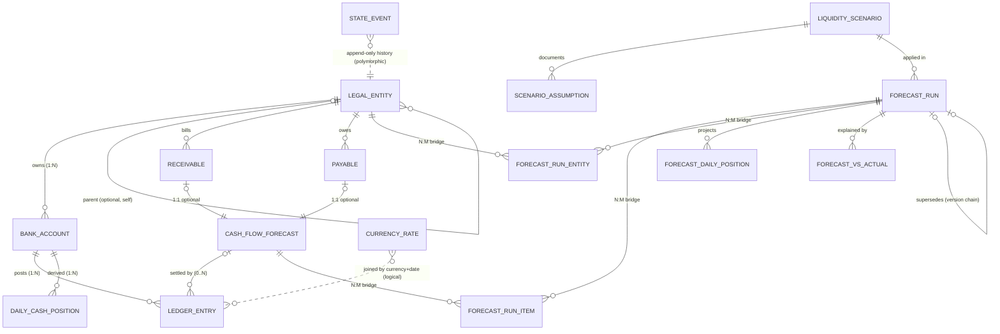

# Entity-Relationship Model

| Relationship | Cardinality | Optional? | Effective-dating / lifecycle |
|---|---|---|---|
| legal_entity -> bank_account | 1:N | no | account `opened_date` >= entity `effective_from`; closed entity closes its accounts |
| legal_entity -> legal_entity (parent) | N:1 | yes (holding has none) | parent id always lower than child (acyclic) |
| bank_account -> ledger_entry | 1:N | no | entries dated 2026-01-01 .. cutoff, none inside a freeze window |
| receivable / payable -> cash_flow_forecast | 1:1 | forecast item optional per doc | item created at invoice date; `revised_expected_date` effective from `revised_at` |
| cash_flow_forecast -> ledger_entry | 1:N | yes (unsettled items) | split payments give 2 entries |
| forecast_run <-> cash_flow_forecast | **N:M** via `forecast_run_item` | - | snapshot of date/amount/FX as known at the run cutoff |
| forecast_run <-> legal_entity | **N:M** via `forecast_run_entity` | - | closed/dormant entities recorded as excluded with a reason |
| liquidity_scenario -> forecast_run | 1:N | no | scenario parameters documented in `scenario_assumption` |
| forecast_run -> forecast_run (supersedes) | 1:1 | yes | re-run keeps old run; both stay in history |
| any lifecycle object -> state_event | 1:N | no | append-only; never updated |

## Lifecycles (see `state_event`)
- **legal_entity:** ACTIVE -> DORMANT | CLOSED
- **bank_account:** OPEN <-> FROZEN, OPEN|FROZEN -> CLOSED
- **receivable:** OPEN -> OVERDUE / PARTIALLY_PAID / PAID / CANCELLED / WRITTEN_OFF
- **payable:** same without WRITTEN_OFF
- **cash_flow_forecast:** SCHEDULED -> DELAYED / PARTIALLY_REALIZED / REALIZED / CANCELLED / WRITTEN_OFF
- **forecast_run:** CREATED -> CALCULATED -> (EXCEPTIONS_FLAGGED ->) APPROVED | REJECTED -> SUPERSEDED
